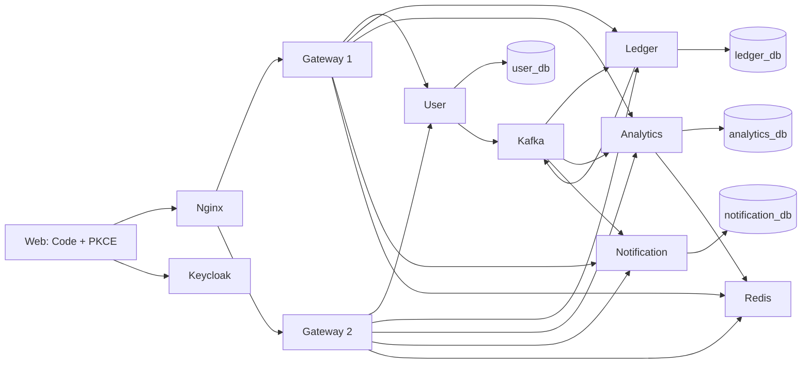

# ESEP — event-driven financial platform

Java21 microservices with Keycloak OIDC, a PostgreSQL double-entry ledger,
transactional outbox, Kafka projections, Redis caching, two API Gateways and Nginx.
Designed to exercise ownership, concurrent transfers, idempotency, failure recovery
and observable asynchronous processing. This is a locally verified portfolio platform;
real customer deployment requires additional security and operational approval.

## Architecture



Ledger alone owns accounts, balances, transfers, postings, financial idempotency
and outbox in one ACID transaction. User owns stable business IDs and verified
issuer/subject mappings. No email-based ownership linking or remote user-database
queries are used. Every service validates tokens and authorizes access independently.
Event delivery is at least once; consumers deduplicate rather than claiming exactly once.

## Run a fresh local environment

Prerequisites: Docker Compose, Python3, Git and the contract-pinned esep-web checkout.
Java21 is required for host Maven tests; Node24/Chromium for browser tests.

```sh
git clone https://github.com/Bakhyzh/esep-web ../esep-web
# Run this checkout only in that fresh clone; preserve existing frontend worktrees.
git -C ../esep-web checkout a70afab85289b299fe49f481fc909b999d25faf6
python3 scripts/platform.py init --frontend-dir ../esep-web
python3 scripts/platform.py build
python3 scripts/platform.py start
python3 scripts/platform.py status
```

Open http://localhost:18081. Keycloak is local at http://localhost:8180. Create human
identities through Keycloak with the intended esep-api USER role. Credentials are
random/private; there are no published default login passwords or default business
ADMIN accounts. First authenticated login provisions the profile and identity events.
The frontend waits for projections before offering financial operations.

Existing installations must retain their original private environments and pass
`--identity-dir /path/to/original/infrastructure/keycloak` to lifecycle commands.
An old broker with misplaced writable-layer logs must use the verified preservation
procedure before recreation. Existing identity databases require verified clone
cutover, not automatic in-place migration. Never regenerate passwords for existing
volumes or use `docker compose down -v`.

The default M1 configuration runs one Ledger and two Gateways. For optional telemetry:

```sh
python3 scripts/platform.py start --monitoring compact
python3 scripts/platform.py start --monitoring compact --dashboards
python3 scripts/platform.py stop
```

Stop retains all volumes and shared identity infrastructure. Grafana/full tracing,
a second Ledger and load/integration suites should be scheduled separately on a4GB
Docker VM. Optional DBA and performance tooling have their own profiles/runbooks.

## Verification

```sh
./mvnw verify
./mvnw -f services/ledger-service/pom.xml verify
./mvnw -f services/user-service/pom.xml verify
./mvnw -f services/notification-service/pom.xml verify
./mvnw -f services/analytics-service/pom.xml verify
./mvnw -f services/api-gateway/pom.xml verify
python3 infrastructure/platform/validate-config.py
python3 infrastructure/production/validate.py
python3 tests/e2e/kafka-security.py
```

Run large Testcontainers suites sequentially with the application stack stopped on
memory-constrained machines. Full browser/API E2E, live event contracts, Kafka
persistence, k6 workloads and controlled faults are executable under tests/.
No production endpoint is accepted by the local fault/performance harnesses.

## Evidence and operations

- [Current state](docs/architecture/CURRENT_STATE.md), [service boundaries](docs/architecture/SERVICE_BOUNDARIES.md)
- [Security](docs/architecture/SECURITY_ARCHITECTURE.md), [database strategy](docs/architecture/DATABASE_STRATEGY.md)
- [Deployment](docs/architecture/DEPLOYMENT_ARCHITECTURE.md), [observability](docs/architecture/OBSERVABILITY.md)
- [Measured performance](docs/architecture/PHASE_H_PERFORMANCE_RESILIENCE_REPORT.md)
- [Backup/restore/PITR and incident runbook](docs/runbooks/platform-operations.md)
- [Production gates](docs/architecture/PRODUCTION_READINESS.md)
- [Final implementation and publication report](docs/FINAL_ESEP_IMPLEMENTATION_REPORT.md)

Production templates require external secrets, verified TLS, restricted roles,
separate migrations, private networking and immutable images. They are not deployed
automatically. Service image publication is explicit opt-in. The retained monolith
is a controlled compatibility source, not a second writer against Ledger accounts.
