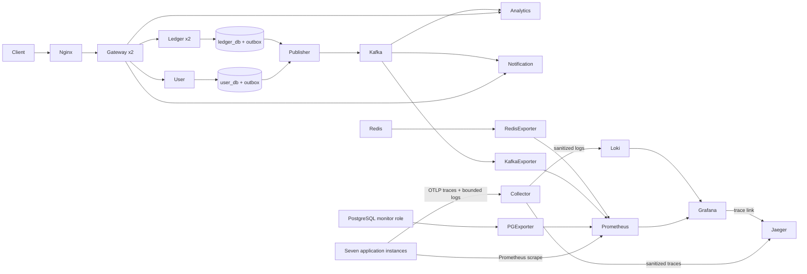
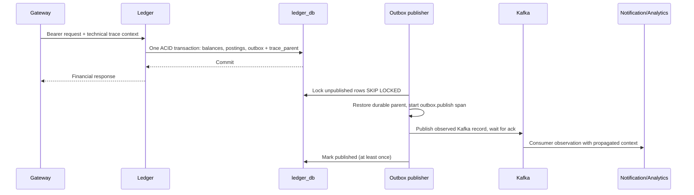

# ESEP observability

Status: implementation under verification in Phase G. Evidence and publication receipt
are maintained in PHASE_G_OBSERVABILITY_REPORT.md. Metrics are observations, never a
source of truth for balances or proof of a committed transfer.



## Run locally

Keep the existing Keycloak environment running and prepare the platform as documented
in the platform runbook. Existing .env.platform must be retained, mode 0600. New
installations get a random Grafana password from init-env.py; existing installations
must append a generated GRAFANA_ADMIN_PASSWORD once without replacing any existing key.

```sh
python3 infrastructure/platform/validate-config.py
docker compose --env-file .env.platform -f compose.platform.yaml -f compose.monitoring.yaml -f compose.monitoring-compact.yaml --profile monitoring build user ledger notification analytics gateway
docker compose --env-file .env.platform -f compose.platform.yaml -f compose.monitoring.yaml -f compose.monitoring-compact.yaml --profile monitoring up -d --no-build --wait --wait-timeout 420
```

Build sequentially on an 8-GB M1 (`COMPOSE_PARALLEL_LIMIT=1`); the secondary instances
reuse primary images. Monitoring is optional. The monitoring override allows a
five-minute cold-start grace on this shared 4-GB Docker VM; readiness must still
return UP and is never fabricated. The compact override disables the second Ledger instance and adjusts the actual
Prometheus target list accordingly. All five business/Gateway applications remain
active, with two Gateways. Use the two-file configuration without the compact
override to run and test two Ledger replicas; stop Grafana during that mode on this
4-GB VM. Full scaling and full dashboard profiles are validated separately locally.
Grafana uses a separate `dashboards` profile. Keep its UI stopped during browser
E2E/load tests on a 4-GB Docker VM; metrics, logs and traces continue collecting.
Start Grafana afterwards with the same Compose files and `up -d grafana`. A
complete simultaneous monitoring UI/authentication workload needs more measured
headroom on this shared M1 host. The override enables Spring's
observability profile on all seven app instances. Without it, exporters are disabled;
Prometheus metrics and safe JSON console logs remain available.

- Edge: http://localhost:18081; its `/actuator` and `/internal` paths remain denied.
- Grafana: http://localhost:13000, user `platform-operator`, private generated password.
- Prometheus: http://localhost:19090; Loki: http://localhost:13100.
- Jaeger UI: http://localhost:16686. Query API is `/api/v3`, not the removed v1 API.
- OTLP receivers and infrastructure exporters have no host-published ports.

These endpoints bind loopback. Prometheus/Loki/Jaeger do not provide public access
authentication here: never expose them to an untrusted network. Grafana provisioning
has Prometheus and Loki sources plus external trace links to the actual Jaeger UI,
avoiding an unverified legacy Grafana Jaeger REST plugin compatibility assumption.

Stop monitoring services by explicit names using the same Compose files. To disable
app exporting, recreate the seven apps using compose.platform.yaml alone. Retain all
volumes. Do not use `down -v` or volume pruning.

The Ledger observability override uses a 448-MiB container with explicit 64/160-MiB
initial/maximum heap. Actual measurements showed about 134 MiB of Metaspace and
about 59 MiB used heap: native memory requires its own headroom. The plain platform
profile retains its existing budget. Grafana uses a 180-MiB Go soft memory limit
inside its 256-MiB container; the soft limit is not a readiness guarantee.

## Signals and privacy

Boot Actuator/Micrometer expose HTTP count, latency histogram/SLO buckets, JVM CPU and
memory, Hikari activity and pending connections. Added gauges sample User/Ledger outbox
count/oldest age every 15 seconds. They return -1 plus `metrics_up=0` when unavailable;
a failed DB poll never appears as a zero backlog. Multiple Ledger gauges describe the
same database: aggregate backlog with max, not sum. Kafka retry/DLT counters contain
only controlled topic names; Analytics cache counters contain only hit/miss labels.

Infrastructure exporters collect PostgreSQL activity/locks/dead tuples/WAL disk size,
Kafka group lag and Redis availability. PostgreSQL uses the existing monitor-only
platform_ops role, never a business writer or superuser. Statement collection does not
include SQL text. A metric missing during a scrape is unknown, not an invented zero.

Nineteen provisioned dashboard panels use real metric names. p50/p95/p99 use actual
histograms; empty traffic windows may be NaN. Financial transfer failure panels count
HTTP failures, not business ledger reconciliation. Alert rules cover scrape loss,
server errors, outbox backlog age/poll failure, Hikari saturation, group lag, DLTs,
Redis failure and sustained authentication/authorization failures. Rules are local
Prometheus alerts; paging/Alertmanager delivery and operational SLOs remain production
work. Alert tests use explicitly synthetic fixtures, not measurements.

Structured console logs use ECS JSON. Deliberate request summaries contain only
registered route templates, bounded method/status and a validated UUID correlation ID.
No request/response body, bearer token, email, subject, account ID or idempotency key is
logged by the added code. SQL exception and raw Kafka recovery logging are suppressed;
safe exception classes and processing counters retain failure visibility.

The official OpenTelemetry Logback appender exports to the Collector. Exported log
bodies are restricted to the two request summary messages; other bodies become
`Application event`. The Collector keeps only an explicit technical attribute/resource
allowlist, removes SQL/URLs/query strings/identity/baggage/exception messages and stack
traces, normalizes span names and clears error status messages. No Docker socket or
cross-database financial query is used for log collection. Local container console
startup logs retain operational detail; restrict their access and retention too.

Client URI metric tags are reduced to the explicit supported API contract. Unknown
paths collapse to `other`; numeric IDs become template parameters; user/authorization
labels are removed. Health/scrape traffic is excluded from request summary logs.

## Durable asynchronous traces



New additive Ledger V4 and User V2 persist only W3C traceparent (55 characters), not
baggage or credentials. Legacy unpublished rows with null context still publish.
A later thread/restarted publisher can attach to the request's trace; the request
span may already have ended. Broker failure/retry retains the same parent. Sampling
and backend retention can still make a trace incomplete. Financial processing never
requires telemetry delivery; bounded queues drop telemetry on sustained collector
outage without changing the money transaction. W3C flag bits are preserved rather
than incorrectly restricting sampled flags to 00/01.

Loki/Prometheus retain 24 hours locally with dedicated persistent volumes. Jaeger is
explicitly bounded **ephemeral** memory (2,000 traces), suitable for this small local
lab, not durable audit/production trace storage. Local sampling is 100% for verification;
production needs a measured sampling policy, durable backend, TLS/authenticated
collectors, access control, independent retention and privacy/security review.

## Verify

After a real Keycloak/platform/browser E2E transfer:

```sh
python3 tests/observability/collector-privacy.py
python3 tests/observability/verify.py --compact
```

The first injects a named synthetic privacy canary through the private real OTLP
receiver and checks stored Loki/Jaeger output. The second requires nine healthy scrape targets in the explicit compact mode
(six application instances, including two Gateways, plus three infrastructure exporters);
without --compact it requires ten targets for the two-Ledger mode. It requires, actual metric series, Grafana dashboard/data source health, real application
logs, all five services' traces and a continuous Gateway → Ledger → durable outbox →
Kafka → Analytics/Notification trace. It scans retrieved telemetry for canaries,
JWT patterns and actual private password values without printing any credentials.
Run financial invariants independently; successful tracing is not financial evidence.

Primary implementation references: [Spring Boot OpenTelemetry](https://spring.io/blog/2025/11/18/opentelemetry-with-spring-boot/),
[Collector transformations](https://opentelemetry.io/docs/collector/transforming-telemetry/),
[Loki native OTLP ingestion](https://grafana.com/docs/loki/latest/send-data/otel/),
[Jaeger v2 configuration](https://www.jaegertracing.io/docs/2.23/deployment/configuration/).
