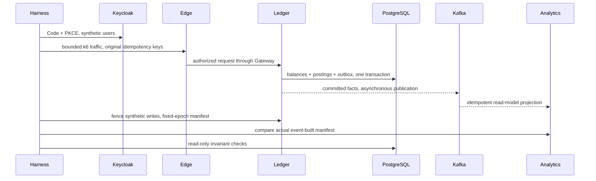

# Performance and resilience verification

The executable laboratory is `tests/performance/`. It uses actual Keycloak, the
edge, both Gateways, independent services, PostgreSQL, Kafka and Redis. Each run
creates its own synthetic actors/accounts and verifies exact balance conservation,
completed transaction counts, double-entry SQL invariants and asynchronous Kafka
projection reconciliation after each case. No production target is accepted.

Commands, fault containment and credential handling are documented in
[the executable laboratory](../../tests/performance/README.md). The Docker profile
is optional and pinned; host k6 avoids consuming scarce Docker VM memory on M1.
The offline CI contract check is clearly separated from actual load execution.

The measured environment is an8GB Apple Silicon shared development host with a
4GB Docker VM. Telemetry is sampled every5seconds; this can miss short peaks and
is not a profiler. Container CPU percentages can exceed100% on multiple cores.
Raw per-case resources preserve CPU, memory, PostgreSQL connections, Kafka lag,
outbox and Hikari measurements. Missing samples are not treated as zero.

The nine workloads cover baseline, normal, bounded stress, spike, a five-minute
soak, opposite-direction financial transfers, concurrent duplicate keys and changed
payload conflicts, analytics reads and Gateway balancing. This is a short local
soak, not evidence of multi-day stability or production throughput. Stress8VU did
not reach saturation. No capacity ceiling or production SLO has been established.

All intentional422 duplicate-payload rejections remain in the raw HTTP error rate;
functional error thresholds separately reject unexpected results. In-flight errors
while killing a financial replica are recorded rather than concealed; recovery must
settle original keys exactly once. Single-host replicas do not provide host HA.

See the Phase H report and its immutable sanitized artifacts for actual results,
resource configurations, discovered failures and verification/publication status.
