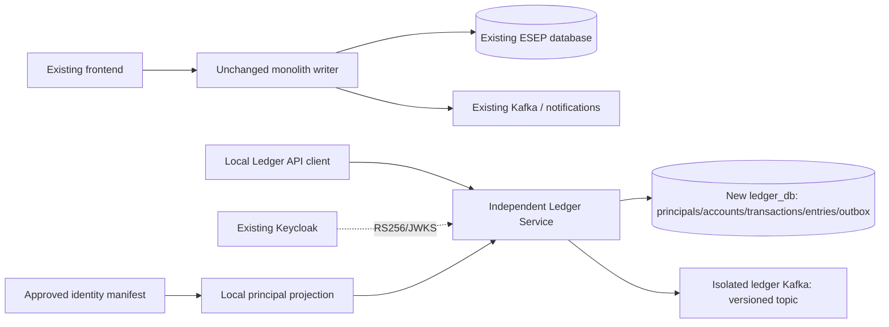

# Phase 3.1: dependency audit and extraction decision

Implementation base: origin/main 91899538af761a5f41a3de65207fd1f2bdcb9b74.
This decision was recorded before creating service source code. Original untracked
architecture documents and db-lab remain in their original worktree untouched.

| Component | Current dependencies | Ledger adaptation |
|---|---|---|
| Accounts | users FK/JPA owner; system currency funding accounts | FK/JPA to local ledger_principals with original numeric IDs |
| Transactions | created_by users FK; per-user key/hash uniqueness | created_by FK to same local principals; no profile/password copy |
| Entries | accounts and transactions FKs; signed decimal postings | same DB/transaction and locking, unchanged calculation logic |
| History | JDBC accounts/entries/transactions joins | local joins unchanged; no users join |
| Outbox | same datasource as transfer; JSON event; Kafka publisher | same atomic boundary, independent topic with versioned payload |
| Notifications | users FK, notifications/processed_events; Kafka consumer | stays in monolith; no consumer or notification tables in Ledger |
| Analytics | accounts/entries SQL, Redis cache; in-process after-commit event | stays in monolith; no Redis dependency or analytics SQL in Ledger |
| Security | issuer/sub -> monolith users identity; token-scoped roles | independently validate JWT; resolve approved local identity projection |

Smallest safe extraction: independent Maven project using Boot 4.1.1/Java 21,
copy the working account/transaction/outbox/common implementation into that project
(no shared entity JAR, no root source-path/classpath dependency). Replace only user
entity references with minimal immutable local principals. Keep all locking,
BigDecimal posting, request fingerprints, replay race and transaction boundaries.
Keep root financial modules, migrations, consumers and routing active against their
own existing database. Ledger uses a new ledger_db with synthetic fixtures only.

Identity is NOT owned by Ledger. ledger_principals is a credential-free reference
projection; ledger_identity_bindings contains independently approved issuer/sub
bindings. A privileged operator bootstrap contract materializes these before API
access. Unknown bindings return 403; neither email nor userId claim can attach an
account. No synchronous identity network request, especially inside a money tx.
A future User Service can supply authenticated/versioned projection updates under
this contract; this phase does not pretend that service/event pipeline exists.

The original draft DATABASE_STRATEGY suggested inheriting the entire monolith
history. The explicit Phase 3.1 instruction supersedes that approach: fresh Ledger
gets its own service-specific V1 baseline, not monolith V1–V8 or user/notification
archives. Existing monolith V1–V8 stay byte-for-byte unchanged. Any later existing-
data migration must transform only approved financial rows and principal bindings
into this new schema under freeze, backup/restore, ID/sequence preservation and
zero-difference reconciliation. No automatic data migration or traffic cutover.

Ledger publishes to esep.ledger.transfers.v1, leaving monolith esep.transfers and
its consumer/group untouched. Separate streams prevent synthetic IDs/events from
being treated as existing production/development financial history. Consumers
must validate schemaVersion and deduplicate eventId; at-least-once, no end-to-end
exactly-once guarantee. Transfer events retain old business field semantics.

No existing account has two writers. No routes, frontend, User/Analytics/
Notification Service, Gateway, Kubernetes or load-balancer implementation changes.
