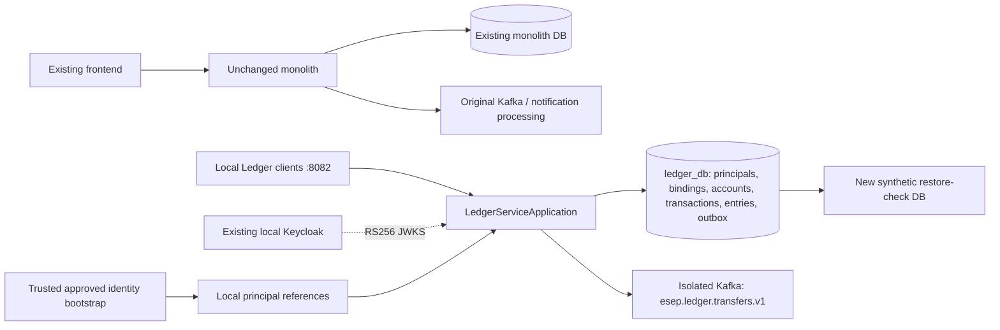

# ESEP Phase 3.1 — standalone Ledger Service extraction

Date: 2026-11-06, Asia/Almaty. Implementation base: origin/main
`91899538af761a5f41a3de65207fd1f2bdcb9b74`; frontend reference `a135211`.
Worktree: esep-ledger-extraction, branch feat/ledger-extraction.

## Result and scope

The standalone Ledger application and its isolated local Compose environment are
implemented and locally validated. Checks covered OIDC login, financial integrity,
concurrency, idempotency, broker recovery and synthetic restore. CI/publication status is recorded below and in the publication
follow-up; local passes alone are not a claim of remote CI completion.

No existing accounts/data were migrated, overwritten or routed to Ledger. No
production deployment, frontend change, shared financial database, second writer
for existing accounts, new User/Analytics/Notification Service, Gateway, Kubernetes
or Load Balancer. The original db-lab and seven untracked architecture documents
remain untouched in their original worktree. Root V1–V8 and application/test sources
are byte-for-byte unchanged against the base commit. The original financial
PostgreSQL container ee16bc0c7ce5f84a1260eea09b2bc0f045f1e7a44e891194bb5487618f55a739
remains stopped with esep-api_esep-pgdata. The Phase 2.3 cutover API/DB/Kafka/Redis
remain running separately; no SQL or migration was run against those databases.

## Audit and extraction choice

Read the architecture/roadmap/security/database documents, Phase 2.1–2.3 reports,
identity runbooks, actual financial/security/Kafka modules, migrations, tests,
Docker/Compose and CI. Refetched and verified origin/main before isolation.
Dependencies were documented **before creating service code** in
[dependency audit](PHASE_3_1_LEDGER_DEPENDENCY_AUDIT.md).

The original monolith has a single lifecycle/datasource: users are referenced by
accounts and transactions.created_by; entries reference accounts/transactions;
outbox shares the transfer transaction; notification FK/dedup and analytics SQL
also use the common DB. A simple package move would retain shared-database
coupling and accidentally bring notification consumers/profile credentials.

The new independent Maven project copies the working account/transaction/outbox
code, replacing only User/UserRepository entity references with LedgerPrincipal
references/repository. No shared root entity JAR, source-directory inclusion or
root application runtime dependency. Java 21 and Boot 4.1.1/dependency versions
are preserved. After normalizing principal type names, Account, LedgerTransaction
and TransactionService are identical to source; TransactionProcessor differs only
in an explanatory comment. Deterministic locking/posting/replay math is unchanged.

The original draft DATABASE_STRATEGY proposed inheriting full monolith history.
The explicit Phase 3.1 requirement supersedes that plan: this fresh ledger_db has
an independent current financial baseline, no monolith histories/user/notification
archives. Existing V1–V8 are never edited or replaced.

## Architecture, ownership and files

- services/ledger-service/pom.xml: independent executable build/dependency tree.
- src/main/java/com/esep/LedgerServiceApplication.java: own Spring lifecycle.
- account/**, transaction/**, outbox/**: owned financial API/business/publisher.
- principal/**: minimal ID reference plus read-only approved identity resolution.
- security/**: RS256-only Resource Server; no password/login/HS256 components.
- common/**: required error/validation/date/pagination/OpenAPI adapters.
- db/ledger/V1__ledger_baseline.sql: independent schema and financial constraints.
- db/ledger/afterMigrate.sql: restricted local runtime grants when the role exists.
- db/local/R__synthetic_system_accounts.sql: explicit local/test system-only seed.
- application.yaml/local/test: separate externalized datasource/issuer/Kafka config;
  no implicit shared DB, no Redis. Base configuration seeds no synthetic principals.
- Dockerfile/.dockerignore/compose.yaml/infrastructure/init.sql/.env.example:
  independent image, non-root JRE, readiness, private persistent local DB/broker.
- scripts/bootstrap-identity.sql, reconcile.sql, live-smoke.py, restore-smoke.py:
  auditable bootstrap, read-only invariants, real OIDC/outage and restore checks.
- contracts/**: exported HTTP OpenAPI plus versioned identity/event JSON schemas.
- copied financial unit/concurrency tests plus independent security/DB/Kafka tests.
- root .dockerignore excludes services from the monolith build context; CI adds an
  independent Ledger job while preserving the original monolith verification job.

Ledger owns accounts, transactions, ledger_entries, outbox_events and all financial
keys/FKs/CHECKs/indexes. ledger_principals and ledger_identity_bindings are local
reference projections, not an identity/profile master. No users/password/email,
notifications/processed_events or analytics tables exist in ledger_db.

Database monetary columns remain NUMERIC(19,4); BigDecimal operations reject excess
precision, preserve nonnegative human balances and balance/posting consistency.
A unique system-account/currency index additionally protects the funding invariant.
Local synthetic funding uses a reserved SYSTEM reference, never an authenticatable
human. Real import must use original source system IDs with local seeding disabled.

## Identity and authorization

Ledger independently verifies JWKS signature with RS256 allowlist, exact issuer,
esep-api audience, required exp/sub/Bearer typ and standard exp/nbf validators with
60-second clock skew. Only resource_access.esep-api.roles USER/ADMIN grant access.
No realm-management/other-client elevation, X-User-Id trust, email linking or local
userId claim trust. ADMIN can top up but cannot spend another user's source account.

The approved contract carries schemaVersion, original userId, issuer, subject and
approvedOperator. A privileged operator verifies ownership and materializes local
references with the dry-run/apply SQL. Identical retries are no-ops; conflicting
identity/user bindings fail. Runtime can only read projection tables. Exact issuer/
subject resolution happens before controller/money transactions and performs no
remote HTTP/user-database call. Unknown or system identity returns 403; no new
business IDs or passwords are minted by Ledger. A future authenticated User
projection transport is explicitly **not implemented** here.

## Financial boundary, API and outbox

All account balances, postings, transactions, idempotency and outbox writes commit
through the same PostgreSQL datasource and transaction manager. Source ownership
is checked, affected accounts lock in ascending ID order, then double-entry
postings/balances and the stable event UUID/payload commit together. The existing
per-created_by/key uniqueness and fingerprint comparison handle concurrent replay;
a uniqueness loser retries the lookup outside its rolled-back transaction.

The financial paths and response semantics remain compatible; only the local host
changes to 8082. No frontend/routing switch is performed. See
[HTTP/identity/event contracts](../../services/ledger-service/contracts/README.md)
and the exported OpenAPI for exact paths, DTOs, errors and idempotency headers.
/api/auth/me remains on the monolith; Ledger exposes no password/profile endpoints.

Transfer payload schemaVersion=1 includes eventType, stable eventId, transaction,
account/user IDs, decimal amount, currency and occurredAt. It uses a separate
esep.ledger.transfers.v1 topic to avoid synthetic-ID collision with legacy events.
Only transfer events are emitted, preserving original behavior; top-ups do not
pretend to be transfer events. Future generalized posting/lifecycle events need
separate consumer-first migration before analytics extraction.

Async publisher preserves the existing outbox implementation, acks=all and producer
idempotence. ACK-before-published_at commit can duplicate messages: at-least-once,
never claimed end-to-end exactly-once. Sender key provides partition affinity,
not global transaction commit order. Multiple SKIP LOCKED publishers can reorder
batches; local deployment uses one publisher. No notification consumer was copied.

## Actual executed tests and validation

Environment: Java 21.0.2, Boot 4.1.1, PostgreSQL 17.11, Kafka 3.9.1,
existing Keycloak 26.7.0, Docker Desktop ARM64. rtk absent; standard shell used.
No sub-agents/delegation. No framework/version upgrades.

| Check | Executed result |
|---|---|
| Root ./mvnw -B verify | PASS: 248 tests, zero failures/errors, 1 opt-in live test skipped (247 executed) |
| Ledger Maven verify | PASS: 83 tests, zero failures/errors/skips |
| Reused financial tests | PASS: accounts/lifecycle, posting/precision, processor/service/history, outbox unit and 5 real concurrency scenarios |
| TransferConcurrencyTest | PASS: 100 random concurrent transfers, 100 opposite-direction transfers, 20 same-key calls, different-request same-key race and different-user same-key isolation |
| LedgerDatabaseIntegrationTest | PASS: fresh independent Flyway validate/history/table ownership, FK/overdraft/unique mapping/account constraints, rollback after actual postings and outbox insertion |
| LedgerSecurityIntegrationTest | PASS: real RSA/HTTP JWKS decoder/filter chain; wrong signature/issuer/audience/exp/nbf/typ, HS256 rejection, role/unknown/system identity, forged identity claims, ownership, ADMIN-not-owner and declared API inventory |
| LedgerOutboxIntegrationTest | PASS: real PostgreSQL/Kafka committed event/headers/version/UUID, unavailable real network endpoint does not undo money; retry publishes retained event |
| Actual Keycloak live-smoke.py | PASS, including rerun on final container image: Code+PKCE, unknown identity denied, dry-run/apply/repeat mappings, numeric IDs, account creation/balance/history, USER/ADMIN, ownership, precision, transfer/replay/conflict/insufficient funds |
| Real container Kafka outage | PASS: stopped only esep-ledger-local Kafka; API financial commit succeeded, pending outbox retained/readiness UP; restart drained same durable row |
| Restricted runtime role | PASS: no superuser/createdb/createrole; no projection mutations or historical entry DELETE; app runs under ledger_runtime, Flyway under ledger_migrator |
| Docker builds | PASS: independent Ledger image and unchanged monolith image built locally |
| Compose up --wait | PASS: independent API/PostgreSQL/Kafka healthy, API readiness UP; actual internal JWKS networking authenticated tokens |
| Compose validation | PASS: Ledger with generated local credentials and separate CI dummy variables; no secret output |
| Synthetic backup/restore | PASS twice: latest new target ledger_restore_check_62a89d22, all financial/projection/outbox/Flyway rows equal, sequence next values above max IDs, zero reconciliation violations |
| Static integrity | PASS: root financial source/test/migration diff empty; Python/JSON syntax checks, ignored .env/target checks; inspected verification logs contain zero complete JWT-shaped tokens |

Final synthetic backup checksum:
18b057e984e6b0c3a616f7636ff7ea4c9e2a7f3b88f1a28cbc9f61cc964a0215.
Backup was streamed privately in memory to a newly created restore database, not
committed or used to overwrite any existing DB. Both restore-check databases and
all synthetic financial fixtures were retained. Temporary Keycloak users were
removed after checks; there are no standing default business ADMIN credentials.

An initial Kafka test used try-with-resources on KafkaTemplate, which does not
implement AutoCloseable; corrected cleanup to explicitly destroy its test producer
factory, then reran the complete Ledger verification successfully. No critical
failure was ignored or assertions weakened.

## Migration, recovery and rollback

The [migration runbook](../runbooks/ledger-extraction-migration.md) specifies backup
and restored-source evidence, write fence/drain, selective import into a fresh
baseline, original ID/time/hash/key/outbox preservation, sequence reset manifests,
financial/ownership/idempotency reconciliation and coordinated Kafka checkpoint/
contract migration. No automatic exporter/importer against real customer data or
monolith schema restoration into Ledger was implemented or executed.

Current synthetic rollback simply stops the independent Ledger process/project,
retains volumes and leaves original monolith ownership/routes/data intact. Before
a future real first write, a controlled route rollback can restore the fenced old
authority; after any new write, that DB is stale. Freeze and reconcile a tested
reverse-delta migration or forward-fix; never restore stale balances or enable two
writers. Production cutover remains blocked until this recovery path is approved.

## Known limitations and production gates

- No real-data migration/cutover or bulk identity synchronization. Operator bootstrap
  is intentionally required; future User transport must authenticate/authorize and
  audit projection updates. Local source master IDs are not inferred from emails.
- No Gateway/routing/frontend switch. Existing analytics and notifications still
  describe the monolith dataset; they do not consume/query this synthetic Ledger.
- Local HTTP Keycloak and single-node PLAINTEXT Kafka/RF1 are development-only.
  Production needs HTTPS issuer/JWKS/hostname/CORS, private management/admin plane,
  TLS/ACLs, external secrets, a separate migration job and validated capacity/DR.
- JWT revocation/role changes are bounded by existing token expiry/skew. Cached
  JWKS keys may allow existing valid tokens during IdP outages; unknown keys fail
  closed. Phase 2.3 live rotation/restart was not repeated as a Phase 3.1 claim.
- No distributed commit, strict global event ordering, immediate token revocation,
  end-to-end exactly-once, cross-service projections or notification side effects
  are claimed. Topic retention/backlog monitoring are later operational work.
- Runtime roles are restricted locally; external production DB/network isolation,
  multi-host failover, real source migration and reverse import remain untested.

## Git and CI publication

The extraction is prepared as a logical implementation commit after local tests,
configuration checks and staged secret scans. Feature-branch CI must pass before
fast-forward integration into main; main push and remote SHA will be verified.
Exact implementation/publication SHAs, scan results and remote CI links are recorded
in the publication follow-up rather than embedding a self-referential commit SHA.
No force push/reset, volume deletion, existing data overwrite or public deployment.

### Confirmed acceptance and publication

**Phase 3.1 local extraction acceptance passed.** Implementation commit:
`6587043164df3d8cae9b3f6c5554e96e97ba35c1`.

[GitHub CI run 42213224920](https://github.com/Bakhyzh/esep-api/actions/runs/42213224920)
completed with conclusion **success** for that exact SHA. Both ledger and monolith
build jobs passed, including Maven integration/concurrency/Flyway/security/Kafka
tests, configuration validation and both Docker builds. Ledger's committed-source
secret scan also passed using the pinned Gitleaks image. This verification
completed before main integration; no partial or failing extraction was merged.

The existing clean main worktree was fast-forwarded to the implementation commit.
A normal push to origin/main succeeded; independent `git ls-remote origin
refs/heads/main` returned exactly
`6587043164df3d8cae9b3f6c5554e96e97ba35c1` before this documentation-only
publication follow-up. Main's normal CI/image pipeline is separate from the
already successful exact-implementation CI run; SSH production deploy remains
explicit manual opt-in. No public deployment was requested or performed.

Local staged-diff Gitleaks 8.30.1 and the exact CI container scanner both reported
**no leaks found** for the final 102-file implementation changeset. One prose-only
false positive in the full-file scan was resolved by clarifying report wording;
no scanner rule was disabled or allowlist added. Whitespace and local Markdown
links passed. .env and target artifacts were ignored and absent from staging;
the local .env has mode 0600. Ledger Docker logs and inspected Maven/live logs
contained zero complete JWT-shaped tokens. The original monolith source/test/
V1–V8 diff is empty; original unrelated work remains unchanged and untracked.

The local Ledger/PostgreSQL/Kafka services remain running and healthy, with
readiness UP on loopback 8082. Existing identity and Phase 2.3 stacks remain
separate. Human test identities were removed; synthetic financial/mapping and
restore-check data remain for audit. Real financial/identity migration, routing
and production hardening still require the runbook gates and explicit approval.
