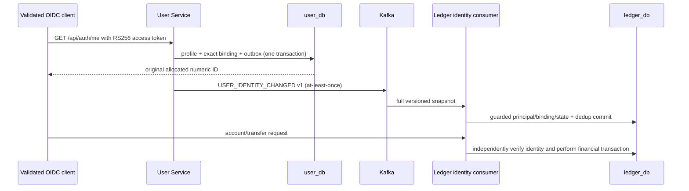

# Phase A — User authority and reliable identity projection

Base: origin/main 3053f8b. Scope: independent User Service plus Ledger's missing
identity consumer. Existing financial algorithms, monolith V1–V8 and original
untracked work are preserved. No real data migration or production switch.

Implemented user_db, independent Maven/Docker/lifecycle, JDBC/Flyway, verified
OIDC auto-provisioning with database-allocated stable IDs, collision rejection,
profile optimistic updates, versioned lifecycle, atomic outbox and esep.users.v1.
No credential management or automatic email linking exists. New ADMIN privileges
come only from explicit Keycloak client role assignments.

Ledger adds V2 reference-projection/dedup tables and a dedicated projector pool/
restricted role. Financial runtime cannot mutate principal bindings. Full snapshots
are applied transactionally with monotonic source versions, payload-hash dedup,
immutable issuer/sub checks and rejection of preexisting unmanaged principal IDs.
System IDs cannot authenticate. Retries/DLT and admin snapshot/replay contracts
support recovery and reconciliation without arbitrary user-ID claims or remote
lookups in money transactions. Manual bootstrap remains an explicit legacy-only
mode, not required by the new isolated platform.

Executed local results:
- User Maven verify: 4 integration tests, zero failures/errors/skips. Real
  PostgreSQL/Kafka and cryptographic HTTP JWKS; concurrent first login, email
  conflict, transactional rollback, lifecycle versions, forged ID/role/issuer/
  audience/signature rejection and ownership of profile identity.
- Ledger Maven verify: 87 tests, zero failures/errors/skips. Existing 83 financial/
  security/Kafka tests plus real Kafka projection/DLT, duplicates/stale snapshots,
  conflicting event IDs, historical principal rejection and immutable mapping checks.
- Monolith regression: 248 tests, zero failures/errors, one opt-in live test skipped.
- Separate User/Ledger images built and unified Phase A Compose started healthy.
- Real existing Keycloak Code+PKCE -> User -> Kafka -> Ledger flow passed, including
  account creation, exact numeric ownership, top-up, transfer, replay, foreign
  account/ADMIN-not-owner denial, disable/enable and snapshot reconciliation.
- All credentials freshly generated in ignored mode-0600 .env.platform; no database
  ports published by the platform. Original financial DB/container/volumes untouched.
- Prior synthetic Phase 2.3/3.1 demo containers were stopped to fit Docker's 4-GB
  VM; their volumes retained. Keycloak remains running with its original volume.

Failures fixed before validation: a numeric JSON test cast, Boot's Object/Object
producer-listener generic requirement and a concurrent Docker image export race.
An overloaded parallel regression run hit pool-acquisition timeouts; stopping the
synthetic stack and rerunning suites sequentially passed all 87 Ledger tests
without changing test deadlines or financial logic. No failed test was skipped.
Producer failure logging in application beans now omits financial payloads.

Replay/reconciliation currently uses privileged paginated admin contracts and the
local E2E checker; production migration of existing human IDs still requires
verified manifests and controlled import. Local PLAINTEXT Kafka/network trust is
not a production ACL design. Identity disable is asynchronous across consumers.
Production hardening and full platform E2E are later master-prompt phases.

CI adds User verification/configuration/secret scanning/image build; Ledger and
monolith jobs remain. Exact Git publication and remote CI status are recorded by
subsequent phase/final reports. Phase B proceeds only after Phase A validation.
