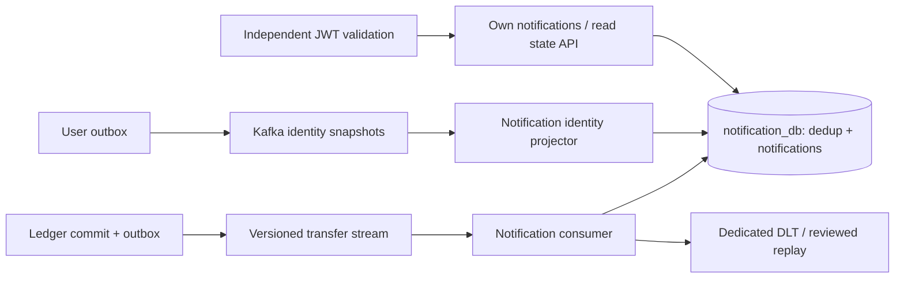

# Phase B — independent event-driven Notification Service

Built on published Phase A (0a8781d). Notification is an independent Maven/Boot
4.1.1 application/image with notification_db, Flyway, health/readiness, own identity
projection and its own Kafka consumer groups. No Ledger/User shared DB queries.

Implemented versioned transfer consumption, immutable event payload-hash dedup,
atomic processed-marker/notification commits, recipient uniqueness, read/unread
state and owner-filtered REST APIs. A financial event may precede identity delivery;
its recipient ID is stored from the trusted financial event, then API access remains
closed until the exact verified identity projection is available. ADMIN does not
implicitly own another user's notifications.

Retry uses actual transaction rollback and bounded backoff; permanent errors go
to dedicated .notification.DLT topics. DLT sends must succeed before recovery.
Reviewed replay uses a Notification-only replay topic and stable event IDs.
The service never participates in or rolls back Ledger money transactions.

Executed results:
- Notification Maven verify: 5 integration tests, zero failures/errors/skips, real
  PostgreSQL/Kafka and actual RSA/HTTP-JWKS authentication.
- Primary delivery plus duplicate plus replay leaves one record per recipient.
  Conflicting event reuse is rejected. Marker/message writes roll back together.
- An actual PostgreSQL 40001 serialization failure from a test-only trigger retried
  successfully, producing two recipient notifications and one processed marker.
- Malformed financial JSON reached the dedicated DLT through the real consumer.
- Own list/read/unread work; another owner cannot read-mark a notification. No
  missing/malformed JWT is accepted. The real E2E also rejects ADMIN ownership.
- Independent Docker image built; User/Ledger/Notification/PostgreSQL/Kafka started
  healthy on the new isolated platform. Existing volumes remain preserved.
- Actual Keycloak -> User -> Ledger transfer -> outbox -> Kafka -> Notification API
  passed, including duplicate-request behavior, precision, read status and identity
  disable/enable propagation. No mock JWT or HTTP event shortcuts in that flow.
- Real Kafka stop/restart preserves a committed transfer, leaves notifications
  pending, and catches up after recovery with exact balance checks (see live log).

Root platform config and idempotent bootstrap extend existing synthetic volumes
with only a new DB/roles. No password reset, data overwrite, real migration or public
traffic switch. Tests and image builds are sequential locally to fit the 4-GB
Docker VM. CI adds a separate Notification integration/scan/image job.

Known boundaries: notifications are in-app, not externally delivered. Identity
suspension is eventually consistent with Kafka. Local broker isolation is not
production ACL/TLS. Retention/replay operational controls and observability are
completed in later master-prompt phases. Exact publication/CI details appear in
later phase/final reports; no production readiness is asserted from local passes.

Publication: main `82997fde4280b8de3b649d6276808eb13e3dd532`, remote
GitHub Actions run `42221287503` completed successfully. No production deployment.
