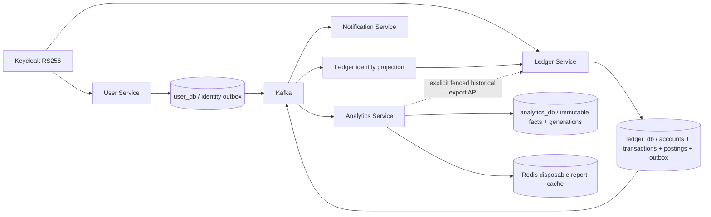

# Phase C — Analytics extraction

Status: implementation, automated tests and actual local stack verified. Remote CI
and publication status are tracked separately; production remains unchanged.

## Architecture and ownership

The monolith's existing SQL reports and DTOs were reused in an independent Java21,
Spring Boot4.1.1 application at `services/analytics-service`. It owns analytics_db,
its own Flyway V1, runtime/migration/projector roles, non-root image and readiness.
The monolith and its V1–V8 migrations are unchanged. No existing financial database
or volume is copied, overwritten or removed.

Authoritative accounts, balances, postings, financial idempotency and outbox stay
in Ledger's one ACID boundary. Analytics contains a rebuildable read model only.
It never queries Ledger's tables or performs a remote identity call within a money
transaction. Each service validates its own exact issuer/audience/RS256/client roles
and resolves identity from the verified local issuer/subject projection.

## Additive Ledger contracts

V3 adds optional target_topic to the outbox and a database-wide financial write
fence with an epoch. Original TRANSFER_COMPLETED v1 remains on the original topic
for Notification. New LEDGER_TRANSACTION_POSTED v1 on esep.ledger.postings.v1
includes **both** postings for transfers and top-ups, stable source IDs, owners,
currency, direction, four-decimal amount strings and authoritative DB timestamps.
ACCOUNT_STATE_CHANGED v1 on esep.ledger.accounts.v1 contains versioned metadata.
Both contracts are in `contracts/events/`.

New facts are inserted in the same transaction as financial changes. Hibernate
flushes before JDBC captures PostgreSQL decimal/timestamp precision, so live and
historical records have the same immutable semantic representation. Asynchronous
publishing retains SKIP LOCKED, stable event IDs and at-least-once semantics.
Parallel publishers may reorder events; no global ordering is promised.

The fence uses a two-integer PostgreSQL advisory-lock namespace shared by every
financial writer. An explicit exclusive pause drains active writes, then advances
the epoch. Export requires writes paused at the supplied epoch. No background task
automatically pauses finances or copies existing real data.

## Projection and API

Processed event hashes reject reuse with different content. Immutable transaction,
posting and account-owner hashes/constraints reject conflicting history. Different
live/backfill event IDs for the same posting do not duplicate aggregates. Account
versions ignore older snapshots and reject same-version conflicts. Malformed facts
are sent to a private Analytics DLT after classification; transient errors retry.

The processed marker, all postings and affected owners' cache generation commit
atomically in analytics_db. Redis keys use this durable generation. A cache outage
falls back to SQL and cannot permanently lose invalidation. Reports are eventually
consistent; they do not claim read-your-write consistency across Kafka.

Existing public report routes, query semantics, BigDecimal results and PostgreSQL
time zone/calendar rules are preserved. USER access stays owner-scoped; existing
explicit ADMIN reporting capability is retained. Spending means outgoing DEBITs;
no unsupported category field, exchange rate or conversion is invented.

## Backfill, reconciliation and rollback

See `services/analytics-service/README.md` for exact startup and operator steps.
The internal ADMIN backfill accepts only an epoch, never client-supplied facts or
a URL. A fixed Ledger address is configured at startup, redirects are disabled,
HTTP timeouts are bounded, and only the caller's validated token is forwarded.
Pages apply in local transactions; every source page and the final check validate
the fence epoch. An interrupted run is repeatable without truncating data.

Compare source/projection manifests for every account, numerical owner, currency,
four-decimal balance and posting count before resuming writes. This validates
complete history, including transactions predating the new event contracts.
Actual source migrations require approved backup, writer fencing and operational
validation; none are performed by this phase.

Rollback stops Analytics consumers/API and preserves financial data/outbox. Route
reports to the monolith only when that monolith owns the corresponding dataset.
Keep additive migrations and the Notification contract. Always explicitly resume
an intentional Ledger fence; never run two authorities for the same accounts.

## Executed verification

On Apple M1/8GB host, Docker Desktop 4GB VM, Java21, 2026-11-06:

- Ledger `./mvnw -B -f services/ledger-service/pom.xml verify`: **89 tests passed**.
  Includes original financial concurrency, opposite transfers, idempotency,
  ownership, PostgreSQL constraints/rollback, RSA validation, Kafka outbox and
  identity tests; new fence-drain/export-epoch and precise two-sided fact tests.
- Analytics `./mvnw -B -f services/analytics-service/pom.xml verify`: **10 tests
  passed**, real PostgreSQL17/Kafka3.9/Redis7. Includes duplicate Kafka delivery,
  historical replay, 16 concurrent duplicate consumers, immutable/version conflicts,
  rollback, exact reports, own/foreign signed JWTs, actual malformed-event DLT,
  cache generations and an actual paused Redis with SQL fallback/recovery.
- Initial failures were test fixture configuration (unassigned mock account ID;
  ambiguous GenericContainer injection). Both were fixed and full suites rerun;
  no tests, deadlines or financial checks were disabled.
- EXPLAIN ANALYZE/BUFFERS over **20,000 synthetic postings** used an Index Only Scan
  on ix_analytics_entries_debit_account_created for a 24-posting period. Detailed
  plan is emitted by the integration test. This is a query-plan check, not a
  production throughput benchmark or SLA.
- Unified Compose configuration validation passed with external private values.

- Both independent Docker images built; the complete four-service stack started
  healthy using the preserved synthetic PostgreSQL/Kafka volumes and Redis.
- Actual `tests/e2e/identity-flow.py --notification-url http://localhost:18084
  --analytics-url http://localhost:18085 --broker-recovery` passed with the real
  existing local Keycloak. It used Code+PKCE, temporary explicit-role identities,
  automatic User provisioning, identity propagation, ownership enforcement,
  exact transfer/replay, both event consumers, read/unread and lifecycle disable/enable.
- Kafka was stopped and restarted. A transfer committed while it was unavailable;
  the retained outbox later reached Notification and Analytics with exact totals.
- The explicit Ledger write fence returned503 on a new transfer. Historical export
  and repeat backfill completed; every source/projection account owner, currency,
  exact balance and entry count matched, including pre-phase-C history. Writes
  resumed in a finally block; temporary Keycloak identities were removed.
- `tests/financial/ledger-invariants.sql` executed successfully on isolated ledger_db:
  account/posting balances, exactly two opposite postings per completed transaction,
  zero-sum currency balances, no human overdraft or duplicate idempotency.
- Synthetic query-plan sample: 24 rows selected from20,000 postings, index-only
  scan, execution0.104ms on this local run. No production performance inference.

Published main `6c1325fb6a38f4fda04a1fd6785a0d7a02e048a7`; GitHub Actions
run `42224430846` completed with all five jobs successful. Remote main SHA verified.
Later master phases D–I,
frontend integration through Gateway, production broker ACL/TLS, verified disaster
recovery and full observability/load tests are **not** claimed complete here.
