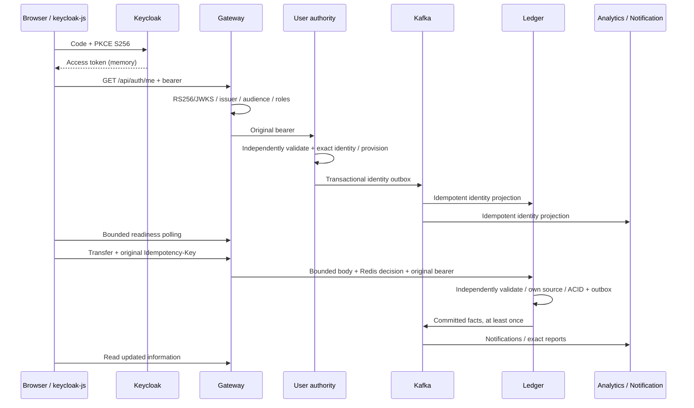

# Phase D — API Gateway and frontend integration

Status: implementation, automated tests and real browser flow verified locally.
Publication/remote CI are tracked separately. Production is unchanged.

Spring Boot4.1.1 remains unchanged. Spring Cloud2025.1.4 is compatible per the
[official matrix](https://spring.io/projects/spring-cloud/); no compatibility
check is disabled. Independent non-root app/image/config/test lifecycle lives at
`services/api-gateway`. It has no writable business database.

The Gateway routes existing public paths and passes business status/error JSON
and idempotency headers through. It denies internal operational endpoints, strips
client identity/forwarded headers, sets bounded correlation IDs, applies exact
CORS and transport timeouts. Stateless OAuth2 resource-server security is enforced
again at every service. USER/ADMIN are esep-api client roles only. ADMIN does not
gain ownership of another source account. No legacy/password-grant route exists.

Redis decisions are atomic across replicas. Mutations fail503 before forwarding
if request protection is unavailable; reads may continue. Rejections429 include
Retry-After. There are no POST retries. Declared and chunked bodies over64KiB are
rejected before business routing. Detailed contracts/rollback/startup are in
`services/api-gateway/README.md`.

The correct esep-web repository was fetched/audited at a135211, then changed in a
separate `esep-web-platform` worktree. Original repositories/worktrees are preserved.
It retains keycloak-js and memory-only tokens. A bounded startup gate resolves
User authority then waits for local projections, preventing the first-login race.
Failure offers retry/sign-out; it does not link by email or repeatedly redirect.
An explicit optional client-ID variable supports later edge hosting. Existing
local5173/esep-web PKCE configuration remains exact and unchanged. Analytics adds
manual refresh and a truthful eventual-update message. No default ADMIN is created.

## Actual verification

- Gateway `mvn verify`:6 tests passed with real HTTP/JWKS/RSA and Redis Testcontainers.
  Valid USER/ADMIN, wrong signature/issuer/audience, expired/not-yet-valid, unrelated
  roles, legacy HS256, new JWKS key, route/bearer/header compatibility, denied
  internal routes, concurrent12-request limit (3 accepted/9 rejected), actual
  Redis pause (mutations503 before forwarding, reads200), CORS, chunked/declared
  body limits and transport504 are checked.
- Initial browser test caught duplicate CORS headers: programmatic routes bypassed
  configured default filters. Routes were moved to supported declarative config;
  a browser-equivalent duplicate-header assertion was added. An oversized-body
  test also found that the shortcut/default guard was insufficient; explicit args
  and a bounded pre-routing body guard now cover chunked requests. The tests were
  fixed by correcting implementation, not weakening checks.
- Frontend lint,31 unit tests and TypeScript/Vite build passed. New readiness tests
  cover projection delay, permanent profile denial, broken dependencies and abort.
- Gateway image built; unified Compose configuration validated; healthy local app
  starts against the four independent business services and existing Keycloak.

- Actual integrated Python smoke passed with all public operations routed through
  localhost18080. Internal backfill/reconciliation remained on restricted loopback
  service endpoints; unknown identity, foreign source, disable/enable and replay
  checks stayed intact.
- Actual Chromium E2E passed: real Keycloak PKCE first login and temporary-password
  activation, automatic User ID/projections, UI account creation, explicit operator
  synthetic funding, UI transfer12.3456, Notification display, Analytics table with
  **12.3456**, no JWT in persistent browser storage and complete Keycloak logout.
  Test5.7s / runner6.6s on AppleM1/8GB. No mock business API or manual SQL identity.
- Post-browser `tests/financial/ledger-invariants.sql` passed against isolated
  ledger_db. Write fence is enabled for normal operation; outbox catches up.
- Browser's initial two-decimal display expectation was corrected: the existing UI
  correctly preserves four decimals. No money-formatting implementation was changed.

Security scans passed. Published backend main `25a28ab78f24d481ec993b0161a7214a2858c619`,
CI `42227334980` all six jobs success; frontend main
`4344375970d63dfeaa108352ce581eec5857831a`, CI `42227415319` success.
Both remote main SHAs verified; public deployments remain disabled.
Later Nginx replicas, DBA/recovery,
observability, load tests and production hardening are not claimed complete here.
