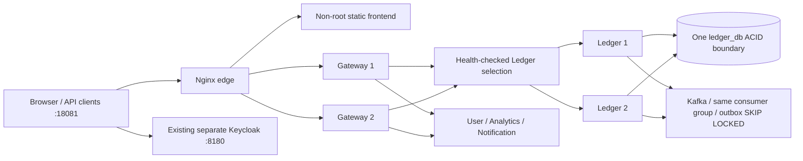

# Phase E — Local edge, replicas and controlled faults

Status: implemented and verified locally. Publication/remote CI are tracked
separately. No production deployment, data migration or multi-host HA claim.

## Topology



Root compose.platform.yaml defines two independently running Gateway processes
and two independently running Ledger processes. Ledger uses one dedicated
ledger_db, not two authorities or independently committed balance databases.
Pessimistic locking, ownership, financial idempotency and atomic postings/outbox
are unchanged. Shared identity projections are protected by their existing
transaction/version/deduplication rules. Consumer groups distribute partitions;
SKIP LOCKED outbox publishers retain at-least-once behavior and possible ordering
changes. Analytics/Notification tolerate that ordering and duplication.

Gateway uses Spring Cloud LoadBalancer with bounded active readiness checks,
static SimpleDiscovery instances, no duplicate caching and no financial request
retry. A failed Ledger can cause transient request failures before health detection;
retrying a transfer must use its original idempotency key. All business services
continue independently validating JWTs and ownership.

Nginx1.30.6 uses a verified multiarchitecture digest, non-root UID, read-only
filesystem, small tmpfs, dropped capabilities, no-new-privileges and graceful
SIGQUIT. It round-robins across Gateways with passive failure detection and dynamic
Docker DNS. It never enables non_idempotent retries. Headers are canonicalized at
the edge and untrusted identity/forwarded headers are discarded by Gateway.
The root environment remains loopback-only; internal databases/Kafka/Redis have
no published host ports. Existing service loopback debug ports support controlled
operations; they are not public production listeners.

Edge imposes64KiB bodies, bounded client/proxy timeouts, connection limits and
request-rate overload protection. It denies internal operations and Actuator paths,
serves the frontend separately, and adds local CSP/referrer/frame/type policies.
Access logs contain bounded service route groups and status/timing, no query,
JWT, password, client IP or financial account path. Ordinary error request-line
logging is disabled by the critical-only error level; monitor status/metrics rather
than collecting sensitive request dumps. This is HTTP localhost configuration;
public TLS/security hardening remains a later reviewed deployment requirement.

## Identity and frontend

A separate esep-platform-web client uses exact localhost18081 callback/origin,
Code+PKCE S256, esep-api audience and permitted USER/ADMIN role scopes. Scope
mappings do not assign roles to people. The original localhost5173/esep-web client,
existing users, realm and financial data are preserved. No default ADMIN is created.
`infrastructure/platform/configure-edge-client.py` creates/validates only this
local client and refuses silent overwrite of an unexpected existing configuration.

The frontend now has its own non-root Dockerfile, pinned nginx runtime, health,
local public build args and `.env.edge.example`. Tokens stay in memory. The complete
existing account/transfer/notification/report UI works through the single edge;
no business logic moved into Nginx or Gateway. Frontend image config/build checks
and edge syntax/security checks are added to their respective GitHub Actions.

## Startup

Use the verified esep-web checkout, not an unrelated local directory. First new
platform setup only (existing `.env.platform` is deliberately never overwritten):

```sh
# In a new Keycloak install only: bash infrastructure/keycloak/keycloak.sh init
bash infrastructure/keycloak/keycloak.sh start
python3 infrastructure/platform/init-env.py --frontend-dir ../esep-web-platform
python3 infrastructure/platform/configure-edge-client.py --identity-dir infrastructure/keycloak
# Build each shared image once; then start, never race build and up.
COMPOSE_PARALLEL_LIMIT=1 docker compose -f compose.platform.yaml --env-file .env.platform build
docker compose -f compose.platform.yaml --env-file .env.platform up -d --no-build --wait
```

In the actual audited workspace the preserved Keycloak environment is in
`../esep-api/infrastructure/keycloak`; the client command used that explicit path.
For an existing platform environment, append only the non-secret
PLATFORM_FRONTEND_CONTEXT pointing to the verified checkout; do not regenerate DB
passwords. For older database ownership setup, follow the idempotent init SQL
procedure documented in the Analytics README. Never remove financial volumes.

Open `http://localhost:18081`; `/ready` tests a Gateway's readiness. `/health`
checks edge process health only. These are not a comprehensive proof of every
business dependency or Kafka projection freshness. Optional monitoring is later.

A pre-existing unrelated Java process listened on IPv6 localhost8080. It was not
stopped or modified. Initial validation caught the collision before provisioning
business data or making a financial write, so edge was moved to18081. Our just-created
unused edge OIDC client was moved after verifying zero sessions; the original
client was untouched. The E2E runner now verifies a known Gateway response before
sending credentials, avoiding accidental requests to another local application.

## Executed verification (2026-11-06, M1/8GB, Docker VM4GB)

- Independent images for all services and static frontend built on ARM64. Both
  Nginx configurations validated as non-root. Actual root Compose startup completed
  healthy for12 platform containers (plus the retained external Keycloak pair).
- Gateway `mvn verify`:7 tests passed. Existing cryptographic/CORS/limits/Redis/
  timeout tests now also run through the replicated profile with two actual HTTP
  backend listeners; unhealthy instance exclusion and restoration are verified.
- Ledger `mvn verify`:89 tests passed, including financial concurrency, opposite
  transfers, idempotency, ownership, constraints/rollback, source facts and fence.
- Frontend lint/31 tests/TypeScript/Vite build passed. No financial logic rewrite.
- Real Keycloak → automatic User → Kafka identity projection → both Ledger instances
  passed. Actual traffic reached **both** Gateway and **both** Ledger labels.
- Gateway SIGKILL during50 ongoing reads: **50 HTTP200**, remaining replica served.
- Ledger SIGKILL during40 concurrent requests sharing8 keys: **8 HTTP201,26 HTTP200,
  6 transient HTTP500**. Original-key retries settled exactly8 distinct logical
  transfers. Source decrease and recipient increase both exactly0.0008. No zero-error
  failover claim: transient failures are an observed limitation.
- Both replica pairs restarted and balanced traffic recovered. The read-only
  financial invariant SQL passed: account/posting equality, two opposite postings,
  zero sum by currency, no human overdrafts or duplicate financial idempotency.
- Actual edge-hosted Chromium flow passed **after** faults: real PKCE/password
  activation, automatic profile/projections, account, synthetic operator funding,
  UI transfer12.3456, notification, four-decimal Analytics and logout. Test29.4s,
  runner30.6s. Temporary Keycloak identities removed; audit/financial data retained.
- Initial tmpfs YAML list commas passed config parsing but failed real container
  creation; quoting fixed it and actual startup was rerun. Initial port collision
  was corrected as above. No tests were disabled or timeouts enlarged.

## Rollback and limitations

Stop edge/replicas without deleting volumes, restore the previous explicit local
frontend URL/client setting, and retain one authoritative Ledger writer for this
ledger_db. Do not route to a monolith with a different dataset. Keep outboxes,
identity projections, migrations and broker data. A source fence is shared by
both financial replicas. Recover uncertain requests with their original keys.

All replicas share one physical host and one PostgreSQL instance. Kafka is RF1;
Redis and edge are single instances. This is **not** production HA or proven
failover of a database. Active health detection has delay; in-flight requests can
fail. Production TLS/ACLs/secrets, backup/restore/PITR, observability and measured
k6/resilience work remain phases F–I. No real financial data or existing db-lab
was touched. Secret scan/publication/CI receipts are recorded after execution.

Publication receipt: backend main `ece425a893a16c91bacc25c479bd984f5b51ff20`,
CI `42239735085` all7 jobs success; frontend main
`a70afab85289b299fe49f481fc909b999d25faf6`, CI `42239146949` success.
Both remote main SHAs verified; no public deployment.
