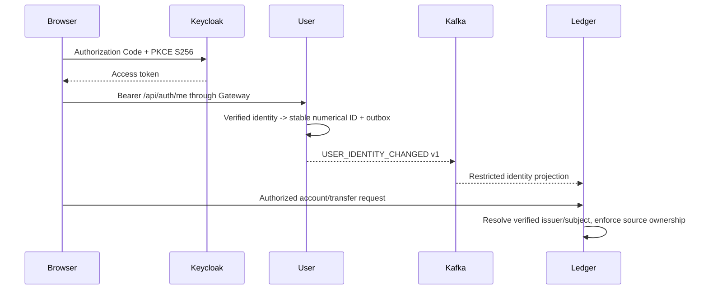

# Security architecture

Browser clients use keycloak-js Authorization Code + PKCE S256 and memory-only
access tokens. API authentication is stateless. Gateway and every service validate
RS256/JWKS, exact issuer, esep-api audience, expiration, not-before and permitted
roles from the intended client. Legacy HS256 is not accepted by platform services.
User Service stores profiles and stable identity bindings, never passwords.

No automatic email linking or client-supplied business identity assignment exists.
Producer authentication and least-privilege Kafka ACLs protect identity/fact trust.
Local SASL/PLAIN is private but unencrypted; production guards require SASL_SSL and
hostname verification. Production also requires verified PostgreSQL TLS, Redis TLS,
HTTPS service endpoints, exact HTTPS CORS and separate migration execution.

JWT logout/role changes do not instantly revoke cached access tokens. Issued tokens
remain usable until expiration unless a local lifecycle projection denies the user.
Lifecycle synchronization is asynchronous and can lag during broker outage. Operational
revocation may require disabling the provider identity and fencing sensitive writes.
Do not promise immediate global revocation or exactly-once event delivery.

Logs exclude JWTs/passwords, raw SQL values, private payloads and query strings.
Collector allowlists/canaries independently check privacy. Security scanning exports
images without mounting Docker socket or private workspace. Findings are reported,
not suppressed. Production approval requires review/remediation of remaining findings,
provider configuration, credential custody and deployment-specific exposure.
