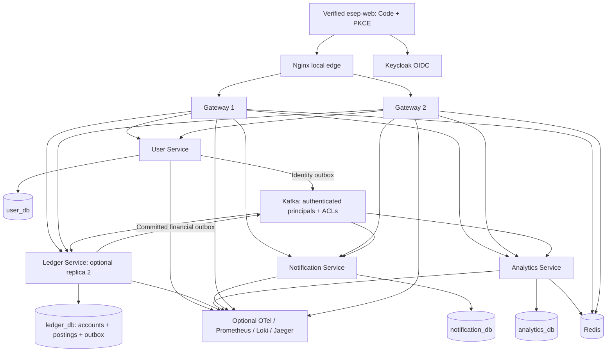

# Implemented architecture and deployment target

Each business service owns a separate database and validates JWTs independently.
Four business databases share one PostgreSQL process locally. This is logical
ownership isolation, not four highly available database clusters. Keycloak has a
separate identity database and retains cryptographic keys and subjects.

The Gateway owns routing and edge policy; Ledger owns every authoritative money
change. Notifications and Analytics consume committed events independently.
No distributed financial transaction or synchronous identity call occurs inside
the money transaction. Replicas on one laptop do not establish host availability.

The production template requires reviewed private networking, external TLS
PostgreSQL/Kafka/Redis/Keycloak, immutable application images and external secrets.
It is configuration preparation, not an executed production deployment.
